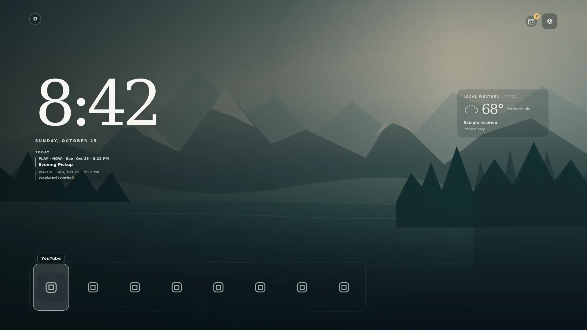
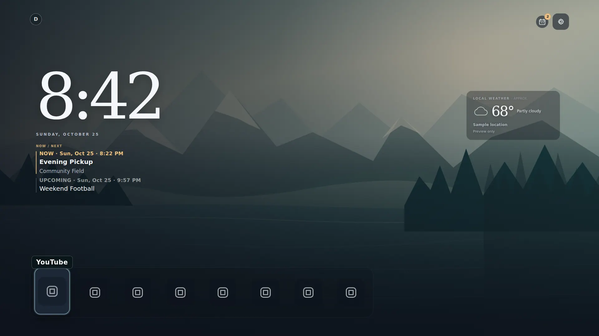
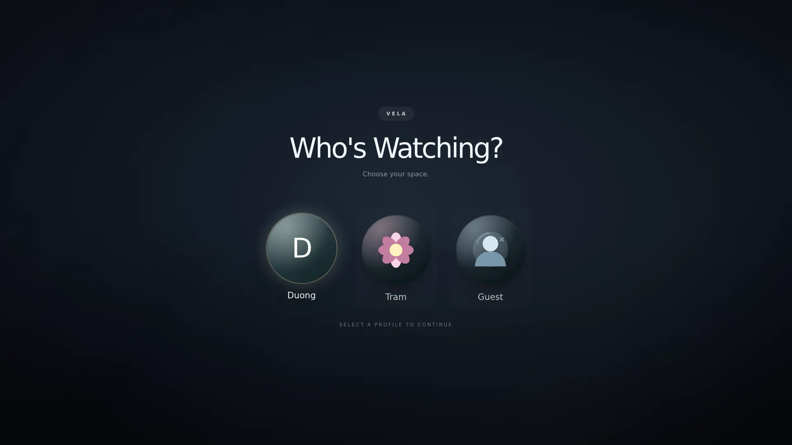
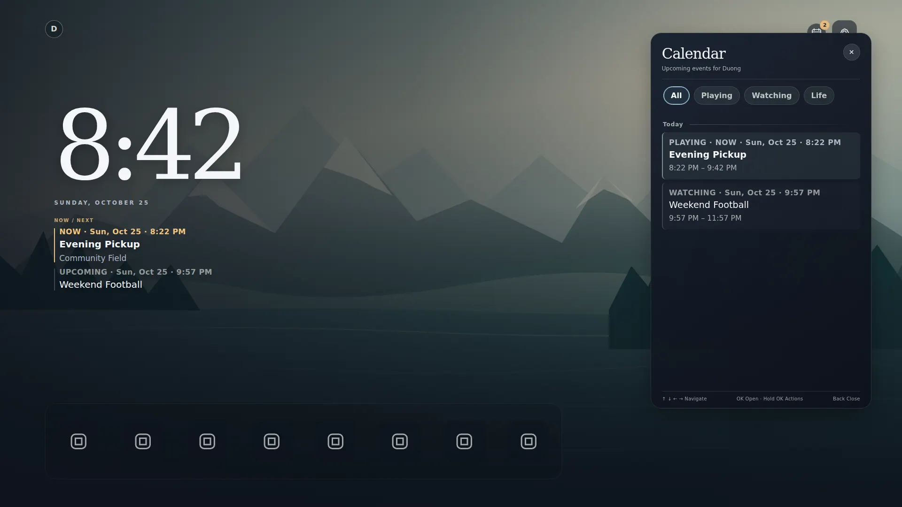
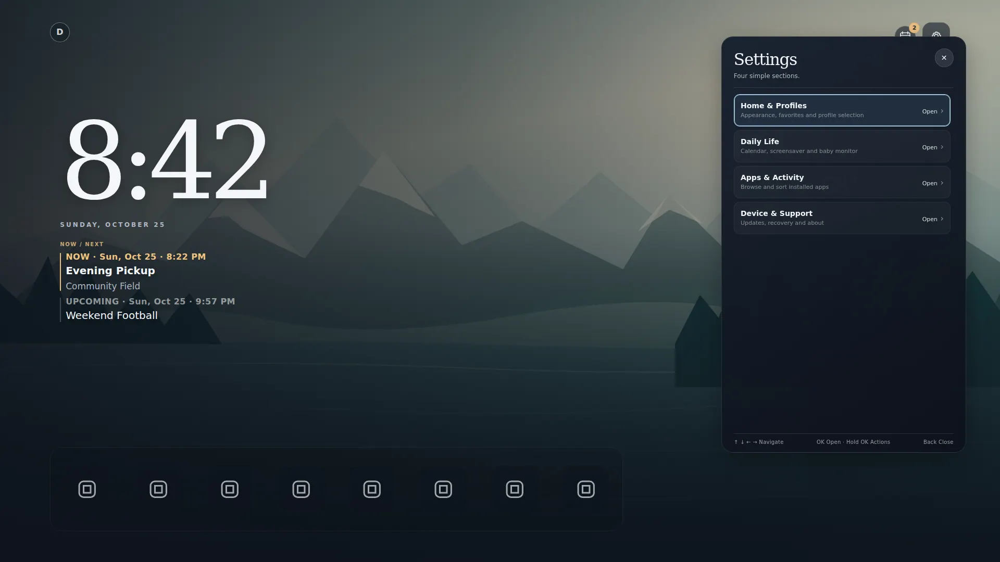
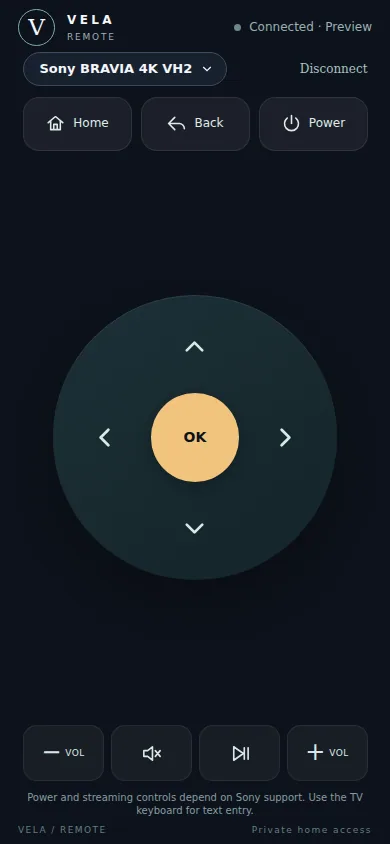

# Vela TV — Quiet Glass v1 living-room review

**State:** source-only design PR, **not** Sony production, Samsung WGT, remote Pages, Worker deployment, or installed TV verification. FRIDAY's [`DESIGN_SYSTEM.md`](https://github.com/vudh1/friday/blob/main/docs/DESIGN_SYSTEM.md) and `design/tokens.v1.json` remain a proposal, not a production dependency. This PR maps selected values locally.

## Editable Figma review

[Vela TV · Quiet Glass v1 Interaction System](https://www.figma.com/design/fOsOBZmiRUjxo2Xm1Rhhqh) now contains native editable frames on three pages:

- **01 · TV Screens:** 1920×1080 Home idle/focus, three circular profiles with selected glow, Playing calendar/Now-Next, native Sony ambient screen, nested Settings. Reusable source-linked tile and medallion focus components.
- **02 · Phone Remote:** 390×844 paired, key pressed, two-TV picker, and disconnected states, with reusable key components.
- **03 · Focus & Platforms:** overscan-safe D-pad state map and separate Sony Android/Google TV versus Samsung Tizen capability/release gates.

FRIDAY/Vela semantic Figma variables (dark palette, focus, accent, spacing and radii) use editable aliases. The source uses Arial/Georgia, which were unavailable in the connected Figma editor; the review file uses **Inter/DM Serif Display as clearly documented design substitutes** and is not asserted to be typographically pixel-identical. Sample events and neutral app artwork proxies are illustrative, not licensed replacements for device-provided installed-app icons. The native source and its optimized original wallpapers remain authoritative; Figma is a review surface, not a runtime asset source.

## Direction and semantic mapping

Calm cinematic Home, minimal outlining at rest, warm light only for events/active controls, and spatial focus that works from a sofa. Do not copy a proprietary UI. Wallpaper is atmosphere, never a legibility or launch dependency.

| Role | Mapped value | Use |
| --- | --- | --- |
| `color.canvas` | `#0D121B` | Fallback background, chooser, phone remote |
| `color.surface.base` | `#18212E` | Nested settings, remote picker |
| `color.surface.raised` | `#243143` | Current row/key and focus elevation |
| `color.text.primary` | `#F4F6FA` | Key legible content |
| `color.text.secondary` | `#ADB7C5` | Secondary time/location/status |
| `color.border.subtle` | `#3C4B5D` | Rare dividers, not tile outlines |
| `color.focus.ring` | `#BCEAFF` | Spatial selection and input outline |
| `color.accent.velatv` | `#F2C47E` | Now, active remote control, soft chooser highlight |

System fonts only. 4 px spacing basis, 12/18/24 px radii, short focus transitions, no full-screen or continuous blur, and reduced-motion suppression. Styles are mapped in the Sony/Tizen shared CSS, native Sony DreamService and phone `ux.css`, not imported from FRIDAY at runtime. Existing optional Light mode is retained; dark is the primary composition reviewed here.

## Screens and focus contracts

All Figma-ready frame specifications use a **1920 × 1080 CSS canvas**, with scalable 3840 × 2160 output at DPR 2, and at least **5% safe-area inset** for TV content. Avoid relying on edge pixels on overscanned sets.

| Surface / variant | Layout and state | Input and exit |
| --- | --- | --- |
| Home / idle / focused / offline | Atmospheric wallpaper, compact profile/calendar/gear controls, large clock, optional approximate weather, Now/Next (max 2), up to 8 app icons. App names show on focus; native installed icons are preserved. | Left/right through dock; up to top controls; OK launches; long OK opens app actions; no network blocking. |
| Profile chooser / cold / manual | Opaque dark full-screen gate. Three circular medallions at equal gaps, names below, no shelf/rest outline, focused-only halo. | Arrows move through profiles. Cold-start Back cannot expose previous-profile Home; manual-switch Back can exit. Editing happens only under Settings. |
| Calendar / filters / event / stale | Right-side drawer, All / Playing / Watching / Life. Date/time and Now status in list; field and user-entered channel on Home when known; full notes only in detail. Saved cache is labeled when unverified. | D-pad through filters and rows, OK opens detail, Back restores row and scroll. The same cross-source fixture is deduplicated by interval/type/title/location. |
| Settings / root / nested / recovery | Home & Profiles, Daily Life, Apps & Activity, Device & Support. Focus background only on active row; no repeated routes. | Gear opens Settings; Back and Left-at-edge return to prior group and focused row. Nested scroll position is restored. |
| Ambient screen / motion phases | Sony native clock, weather only when fresh, verified encrypted cached event rows, subdued wallpaper. Offset clock and companion content every five minutes. | Sony DreamService only; noninteractive. Samsung's own system screen saver is unaffected. |
| iPhone remote / active / press / lost focus / reconnect / disconnected | 390 × 844 and safe-area responsive, no vertical page scroll, model-labeled pill for at most two selected Sony TVs, D-pad/media/power. Gold OK and clear pressed state; stale gestures invalidated across app switching. | Pointer hold/release and assistive click each send once. Only selected TV receives commands; pairing/revocation semantics unchanged. Phone text input remains intentionally absent; use TV keyboard. |

The original Vela profile SVGs are vector medallions; installed app icons remain the Android high-density icon cache or permitted Samsung-provided art. The `preview/` demo intentionally shows generic fallback symbols because it does **not** ship fake Netflix/YouTube/Apple brand marks.

## Coordinated artwork — curated existing original set

The four already bundled original photo-style scenes are **Misty Lake / Blue Coast / Amber Dunes / Lavender Bay**. Each has a 3840×2160 WebP (~232–404 KiB), a 1280×720 fallback and a 680×383 thumbnail; native Sony screensaver chooses a sampling level based on physical display mode and decodes RGB_565. Four original scalable SVG landscapes remain additional choices. Source history and rights are recorded in `WALLPAPER-CREDITS.md`; no third-party brands, unlicensed Canva exports or rasterized controls were added. Further Canva artboards would be an optional review asset and should not replace a wallpaper without an optimized export/provenance pass.

## Synthetic visual snapshots

These are headless Chromium source previews — **not actual Sony/Samsung screenshots or verified app-brand icon quality**. Synthetic fixture names/location/weather are not connected to a real account.

Before/after (same synthetic clock, viewport and wallpaper):

| `main` before | This review branch |
| --- | --- |
|  |  |

The update emphasizes readable Now/Next, a known field and a stronger single focus state while keeping the original atmosphere. Screenshots do not show the Android-resolved third-party app icon cache.

| 1080p TV Home | Cinematic selector | Calendar | Nested settings | iPhone 390 px |
| --- | --- | --- | --- | --- |
|  |  |  |  |  |

`home-4k-scaling.webp` is rendered as **1920 CSS pixels × DPR 2**, yielding 3840 × 2160 image pixels. Reproduce locally with `VELA_CHROMIUM_PATH=/path/to/chromium node scripts/capture-quiet-glass.cjs`; this optional script requires locally installed `playwright` and `sharp`, not part of the TV application or its CI dependencies.

The optional browser capture now asserts that the paired phone remote fits without vertical scrolling at **320×568, 375×667, 390×844 and 430×932**, with a visible TV-switch pill. It also prints elapsed time to first Home app card in desktop headless Chromium (one local sample: ~104 ms). This is a synthetic DOM-readiness diagnostic, **not** Android cold-start latency, Sony memory use, Safari validation, or a production performance benchmark. The 4K screen now uses the same fixed preview clock as 1080p for repeatable snapshots.

## Platform and security boundaries

| Sony Android/Google TV | Samsung Tizen |
| --- | --- |
| Android launcher, native DreamService, local encrypted iCal cache and signed APK production gate. Optional IRCC, accessibility and phone remote vary by firmware and permissions. | Regular WGT app; cannot replace system Home or screensaver at power-on. Tizen KeyManager/AES-GCM private calendar cache; per-device cert/DUID and local launch requests vary by firmware. No Sony phone remote. |

Preserved: Google + BallerWatch read-only ICS, native app launching, package/signing identity, offline Home/cache, local per-profile history, Guest no calendar cache, private URL/PIN/PSK isolation, Cloudflare four-phone-per-TV leases and separate queues, and no Kept data/FRIDAY runtime dependency. No backend protocol or billing change.

## Device acceptance checklist (must remain open until observed)

- [ ] Sony: cold start and manual profile switch never flash the previous profile; Guest exposes no saved source or reminders.
- [ ] Sony: verify startup time, first D-pad response, app-icon decode/cache memory and 1080p/4K focus at 10 feet; exercise preferred apps, native streaming app launch, and reduced motion.
- [ ] Sony: test Now/Next at 1–2 hours, ongoing past midnight, DST rollback/forward, duplicate feeds, stale/offline source, encrypted cache revocation and settings focus/scroll restoration.
- [ ] Sony: test DreamService after 30+ minutes, clock displacement, weather staleness, burn-in-conscious contrast, idle CPU/GPU and memory footprint.
- [ ] iPhone Safari: 390/430 px, safe areas, dynamic text, Home Screen PWA/background/foreground while holding Up and Volume, synthetic click suppression, reconnect, revocation, public-network mismatch, two-TV picker and four independent pairings.
- [ ] Sony: confirm ARC volume, power toggling/wake limitations, optional native-app control, and relay latency/Free quota **on hardware**.
- [ ] Samsung QN85: sign WGT for that device, inspect focus/Back and application launches, CORS-restricted feeds and offline cache. Do **not** claim native screensaver or launcher parity.
- [ ] Final code/visual review, CI green, owner-led production promotion and installed-device smoke check on both target TVs.

**Rollback:** no migration or credential change. Revert this PR if a source regression appears; keep current production branch and installed app intact. A reviewed future Sony promotion must retain the installed APK signing certificate; a Samsung WGT needs its own signing/install path. Source/CI/preview does not authorize either.
